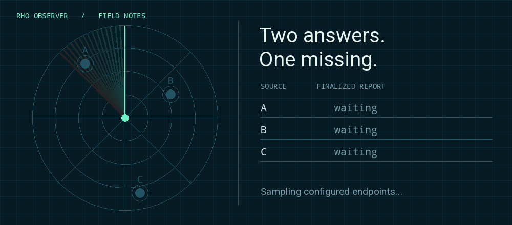
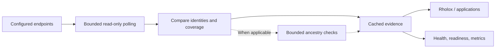

# Rho Observer

**A green light is not the whole story.**

[](https://github.com/rhovision-org/rho-observer/actions/workflows/ci.yml) [](LICENSE)

Created by **[AixAria](https://github.com/aixaria0)** ([@aixaria0](https://github.com/aixaria0)).

Imagine checking a network with three nodes. Two give you the same answer. The third never replies. Is the network healthy?

You know that two answers agree. You don't know what the missing node would have said.

That small distinction is why Rho Observer exists. I wanted a way to see the evidence instead of trusting a single gateway or a reassuring green indicator.



[Still image](docs/motion/overview.png) · [How the animation was made](docs/motion/README.md)

## See it for yourself

[Open Rholox](https://rholox.com/#rho-observer) to see the browser workspace, or open the [public observation report](https://testnet.rhobot.net/observer/v1/observation) directly. No wallet or transaction is needed. These are existing hosted services, whose availability and deployed revision can change.

Observer asks configured Rholo/RChain endpoints what they know about finalized blocks. It compares the answers, keeps failed requests visible and serves a cached report to applications. Where applicable, it can check a bounded path through raw block history.

The interesting part is what it refuses to hide:

- Agreement with missing sources is not full coverage.
- Different heights need not mean conflicting histories.
- A responding service is not necessarily ready.

The report exposes these distinctions instead of collapsing them into one boolean.

## Run your own observer

With Git and a stable Rust toolchain:

```sh
git clone https://github.com/rhovision-org/rho-observer.git
cd rho-observer
cargo build --release --locked
./target/release/rchain-observer --node A=http://127.0.0.1:40403 --node B=http://127.0.0.1:41403 once
```

Replace the example local addresses with endpoints you are authorized to observe. For a continuously refreshed HTTP service, use the `serve` subcommand:

```sh
./target/release/rchain-observer --node A=http://127.0.0.1:40403 --node B=http://127.0.0.1:41403 serve --listen 127.0.0.1:8088 --refresh-ms 5000 --stale-after-ms 30000
```

Then visit `/v1/observation` for the report, `/health` for liveness and `/ready` for the readiness decision. Applications can also scrape `/metrics`. Repeated reads use the cache, rather than repeatedly polling the underlying nodes.

## Behind the picture



## Trust boundary

Observer never signs transactions, proposes blocks or changes validators. It is not an independent Casper implementation, a stake-weighted quorum certificate or proof that configured endpoints are independently operated. It reports evidence and uncertainty; the application decides what to do with it.

The [technical guide](docs/GUIDE.md) includes the API schema, verdict definitions, resource bounds, verification matrix, deployment history and rollback procedure. See the [assurance matrix](docs/ASSURANCE.md), [DApp integration guide](docs/BUILDING-DAPPS.md), and [current CI](https://github.com/rhovision-org/rho-observer/actions). The historical dependency audit failure RUSTSEC-2026-0592 was addressed in the lockfile by updating url to 2.5.9; All four jobs, including cargo audit, passed in the [dependency-fix CI run](https://github.com/rhovision-org/rho-observer/actions/runs/45798347508). No live service upgrade is implied.

## The Rho family

- **[Rho Weave](https://github.com/rhovision-org/rho-weave)** — Find a safe next move when information is missing.
- **[Rho Forge](https://github.com/rhovision-org/rho-forge)** — Turn resource flows into executable actors.
- **[Rho Foundry](https://github.com/rhovision-org/rho-foundry)** — Turn guarded rules into executable contracts.

Observer is the eyes, not the decision-maker. Weave can help a developer design what to do with uncertain observations. Forge and Foundry are two ways to generate the contract logic that runs underneath an application.

They share a direction, not an automatic integration. [See how the pieces could fit together](docs/ECOSYSTEM.md).

## License and attribution

[Apache License 2.0](LICENSE) · [NOTICE](NOTICE)

Project creator and lead developer: [AixAria (@aixaria0)](https://github.com/aixaria0). Contributors retain rights in their respective contributions. Hosting in RhoVision is not a transfer of authorship.
