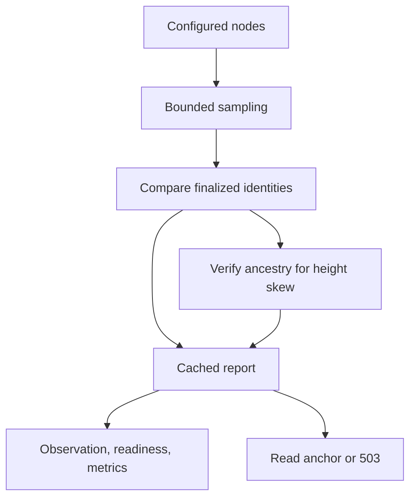

# Working on Observer

`src/main.rs` builds the CLI and starts the sampling loop. `src/observer.rs` collects bounded responses from the configured nodes. `src/verdict.rs` compares the reported identities, and `src/ancestry.rs` walks verified raw-block links where reports disagree on height. The HTTP service reads the cached sample. `src/anchor.rs` decides whether that sample supplies a usable read anchor.



The API, sampling limits, deployment notes and error cases are in the [technical guide](GUIDE.md). The [anchor contract](READ-ANCHOR.md) describes exactly when the service can name a block. For use around an application, see the [DApp guide](BUILDING-DAPPS.md).

`tests/` contains loopback HTTP fixtures for node and service behavior, along with tests for ancestry and verdicts. Use stable Rust with rustfmt and clippy for changes.

```sh
cargo fmt --all -- --check
cargo clippy --all-targets --all-features --locked -- -D warnings
cargo test --all-targets --all-features --locked
```

For a change to classification, include the exact reports that should produce the verdict. For a change to the read API, show what the caller receives and what happens when a source becomes stale or unreachable. The [assurance matrix](ASSURANCE.md) records the boundaries each case should preserve. [CI workflow](../.github/workflows/ci.yml)
